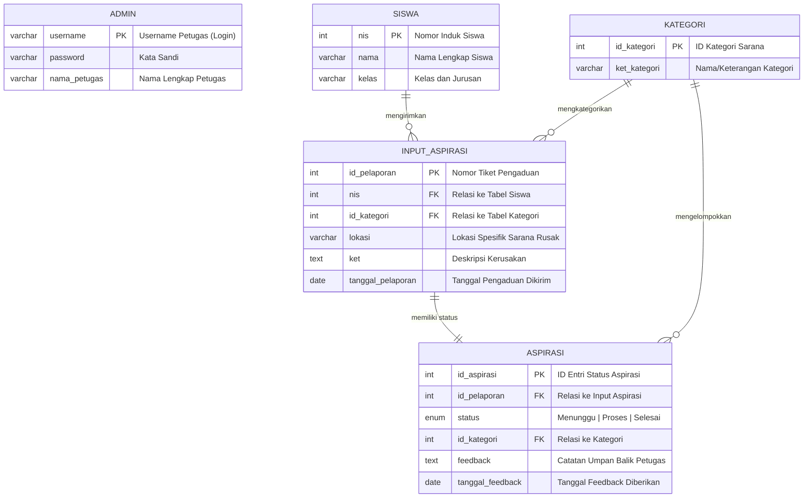
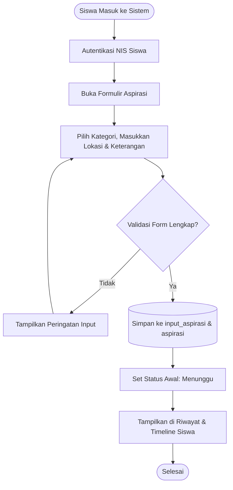
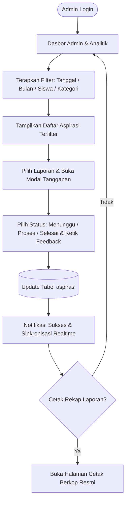

# DOKUMENTASI LENGKAP SPESIFIKASI UJI KOMPETENSI KEAHLIAN (UKK)
## REKAYASA PERANGKAT LUNAK (RPL) / PENGEMBANGAN PERANGKAT LUNAK DAN GIM (PPLG)
### APLIKASI PENGADUAN DAN ASPIRASI SARANA SEKOLAH BERBASIS WEB

---

## DAFTAR ISI
1. [Deskripsi dan Tujuan Aplikasi](#1-deskripsi-dan-tujuan-aplikasi)
2. [Kesesuaian dengan Spesifikasi Soal UKK RPL](#2-kesesuaian-dengan-spesifikasi-soal-ukk-rpl)
3. [Arsitektur dan Struktur Proyek](#3-arsitektur-dan-struktur-proyek)
4. [Perancangan Basis Data (ERD & Kamus Data)](#4-perancangan-basis-data-erd--kamus-data)
5. [Alur Kerja Sistem (Flowchart & Use Case)](#5-alur-kerja-sistem-flowchart--use-case)
6. [Fitur Unggulan Antarmuka (UI/UX)](#6-fitur-unggulan-antarmuka-uiux)
7. [Panduan Instalasi & Pengoperasian](#7-panduan-instalasi--pengoperasian)
   - [Opsi A: Versi Interaktif Client-Side (Langsung Buka di Browser)](#opsi-a-versi-interaktif-client-side-langsung-buka-di-browser)
   - [Opsi B: Versi Backend PHP Native & MySQL (XAMPP / Laragon)](#opsi-b-versi-backend-php-native--mysql-xampp--laragon)
8. [Matriks Pengujian Sistem (Test Cases UKK)](#8-matriks-pengujian-sistem-test-cases-ukk)
9. [Tanya Jawab Ujian Sidang UKK RPL](#9-tanya-jawab-ujian-sidang-ukk-rpl)

---

## 1. DESKRIPSI DAN TUJUAN APLIKASI

**Aplikasi Pengaduan Sarana Sekolah** adalah sistem informasi interaktif berbasis web yang dibangun untuk mendigitalisasi proses penyampaian, verifikasi, pemrosesan, dan pelaporan kerusakan atau usulan pemeliharaan fasilitas sarana dan prasarana di lingkungan sekolah.

### Sasaran Pengguna:
1. **Siswa**:
   - Menyampaikan pengaduan/keluhan mengenai sarana sekolah yang rusak atau membutuhkan perbaikan secara transparan.
   - Memantau progres perbaikan melalui indikator tahapan status (*Menunggu*, *Proses*, *Selesai*).
   - Melihat catatan umpan balik (*feedback*) resmi dari tim sarana prasarana sekolah.
2. **Administrator / Petugas Sarana Prasarana (Sarpras)**:
   - Memantau dasbor analitik pengaduan secara terpusat (*realtime metrics*).
   - Melakukan filter data pengaduan secara multi-parameter (per tanggal, per bulan, per siswa/NIS, dan per kategori sarana).
   - Memberikan tanggapan (*feedback*) serta mengubah status tahapan perbaikan.
   - Melihat rekam jejak (*histori*) penanganan fasilitas dan mencetak rekapitulasi laporan resmi.

---

## 2. KESESUAIAN DENGAN SPESIFIKASI SOAL UKK RPL

| Kriteria Soal UKK RPL | Implementasi pada Aplikasi | Status |
| :--- | :--- | :---: |
| **Dua Aktor Pengguna** | Role Siswa (Portal Input & Riwayat) dan Role Admin (Dasbor, Filter, Feedback, Histori). | **Lengkap** |
| **Formulir Aspirasi Siswa** | Input NIS (otomatis), Kategori Sarana, Lokasi Spesifik, dan Keterangan Kerusakan dengan validasi client & server. | **Lengkap** |
| **Riwayat & Status Siswa** | Pemantauan status (*Menunggu, Proses, Selesai*), visual progress stepper 3-tahap, dan kotak tanggapan admin. | **Lengkap** |
| **Tabel Admin Keseluruhan** | Tabel data komprehensif menampilkan seluruh pengaduan siswa lengkap dengan badge status dan waktu. | **Lengkap** |
| **Fitur Filter Admin** | Multi-filter interaktif: per tanggal (`date`), per bulan (`YYYY-MM`), per siswa (`NIS`), per kategori, dan live search. | **Lengkap** |
| **Umpan Balik & Status** | Modal dialog interaktif untuk memperbarui status dan menginput catatan feedback bagi siswa. | **Lengkap** |
| **Histori & Cetak Laporan** | Halaman log seluruh aspirasi yang telah diproses dan template cetak dokumen resmi berkop surat sekolah. | **Lengkap** |
| **Rancangan Database (ERD)** | 5 Tabel sesuai spesifikasi: `admin`, `siswa`, `kategori`, `input_aspirasi`, dan `aspirasi`. | **Lengkap** |
| **Dua Varian Eksekusi** | Tersedia varian **Web Interaktif Mandiri** (HTML5 + CSS Lokal + JS State) dan **PHP Native + MySQL**. | **Lengkap** |

---

## 3. ARSITEKTUR DAN STRUKTUR PROYEK

Aplikasi ini dirancang dengan struktur direktori yang rapi, modular, dan bersih:

```text
proyek5/
├── index.html                  # Aplikasi Web Interaktif Mandiri (HTML5 Semantic)
├── DOKUMENTASI_LENGKAP.md      # Dokumen Teknis & Manual Pengujian UKK RPL
├── README.md                   # Petunjuk Cepat (Quick Start Guide)
│
├── css/
│   └── style.css               # Desain CSS Lokal Murni (Modern, Responsif, Print Layout)
│
├── js/
│   ├── data.js                 # State Management & Mock Database Sesuai ERD (LocalStorage)
│   └── app.js                  # Prosedur Manipulasi Data, Multi-filter, Event Listener, Stepper
│
└── php-mysql/                  # Implementasi Backend Penuh PHP Native + MySQL
    ├── database.sql            # Script DDL/DML Pembentukan Database & Data Awal
    ├── koneksi.php             # Koneksi Database MySQLi & Fungsi Helper
    ├── index.php               # Router / Session Redirect
    ├── login.php               # Halaman Login Multi-Role (Tab Siswa & Admin)
    ├── logout.php              # Penghentian Sesi Pengguna
    ├── siswa_dashboard.php     # Dasbor Siswa: Form Pengaduan & Riwayat Status
    ├── siswa_proses.php        # Script Pemroses Input Aspirasi Siswa
    ├── admin_dashboard.php     # Dasbor Admin: Analitik, Multi-Filter, Tabel, & Modal
    ├── admin_feedback.php      # Script Pemroses Update Status & Tanggapan Admin
    ├── admin_histori.php       # Rekam Jejak / Log Keseluruhan Pengaduan
    ├── cetak_laporan.php       # Format Cetak Laporan Resmi Berkop Surat untuk Penguji
    └── css/
        └── style.css           # Salinan CSS Lokal Mandiri untuk Lingkungan XAMPP
```

---

## 4. PERANCANGAN BASIS DATA (ERD & KAMUS DATA)

### Diagram Relasi Entitas (Entity Relationship Diagram - Mermaid)



---

### Kamus Data (Data Dictionary)

#### 1. Tabel `admin`
Menyimpan data identitas dan kredensial login staf sarana dan prasarana sekolah.

| Nama Kolom | Tipe Data | Ukuran | Atribut | Keterangan |
| :--- | :--- | :---: | :---: | :--- |
| `username` | VARCHAR | 50 | PRIMARY KEY | Username akun login admin |
| `password` | VARCHAR | 255 | NOT NULL | Kata sandi akun |
| `nama_petugas` | VARCHAR | 100 | NULL | Nama lengkap staf/administrator sarpras |

#### 2. Tabel `siswa`
Menyimpan data identitas siswa yang berhak menyampaikan aspirasi.

| Nama Kolom | Tipe Data | Ukuran | Atribut | Keterangan |
| :--- | :--- | :---: | :---: | :--- |
| `nis` | INT | 11 | PRIMARY KEY | Nomor Induk Siswa |
| `nama` | VARCHAR | 100 | NOT NULL | Nama lengkap siswa |
| `kelas` | VARCHAR | 20 | NOT NULL | Tingkat kelas dan kompetensi keahlian |

#### 3. Tabel `kategori`
Menyimpan kelompok klasifikasi sarana dan prasarana sekolah.

| Nama Kolom | Tipe Data | Ukuran | Atribut | Keterangan |
| :--- | :--- | :---: | :---: | :--- |
| `id_kategori` | INT | 11 | PRIMARY KEY, AUTO_INCREMENT | ID unik kategori sarana |
| `ket_kategori` | VARCHAR | 100 | NOT NULL | Nama kategori (misal: Ruang Kelas, Lab Komputer) |

#### 4. Tabel `input_aspirasi`
Menyimpan entri pelaporan keluhan/kerusakan fasilitas dari siswa.

| Nama Kolom | Tipe Data | Ukuran | Atribut | Keterangan |
| :--- | :--- | :---: | :---: | :--- |
| `id_pelaporan` | INT | 11 | PRIMARY KEY, AUTO_INCREMENT | Nomor tiket pelaporan |
| `nis` | INT | 11 | FOREIGN KEY (siswa.nis) | NIS siswa pelapor |
| `id_kategori` | INT | 11 | FOREIGN KEY (kategori.id_kategori) | Kelompok sarana yang dilaporkan |
| `lokasi` | VARCHAR | 150 | NOT NULL | Titik lokasi spesifik sarana |
| `ket` | TEXT | - | NOT NULL | Deskripsi detail kerusakan |
| `tanggal_pelaporan`| DATE | - | NOT NULL | Tanggal laporan dibuat |

#### 5. Tabel `aspirasi`
Menyimpan rekam jejak status perbaikan, umpan balik dari tim sarpras, serta relasi ke pelaporan.

| Nama Kolom | Tipe Data | Ukuran | Atribut | Keterangan |
| :--- | :--- | :---: | :---: | :--- |
| `id_aspirasi` | INT | 11 | PRIMARY KEY, AUTO_INCREMENT | ID status penanganan |
| `id_pelaporan`| INT | 11 | FOREIGN KEY (input_aspirasi.id_pelaporan) | ID pengaduan yang ditanggapi |
| `status` | ENUM | - | 'Menunggu', 'Proses', 'Selesai' | Status tahapan pengerjaan |
| `id_kategori` | INT | 11 | FOREIGN KEY (kategori.id_kategori) | ID kategori terkait |
| `feedback` | TEXT | - | NULL | Tanggapan / keterangan tindak lanjut |
| `tanggal_feedback`| DATE | - | NULL | Tanggal feedback diberikan |

---

## 5. ALUR KERJA SISTEM (FLOWCHART & USE CASE)

### Flowchart 1: Alur Pengaduan Siswa


### Flowchart 2: Alur Penanganan & Umpan Balik Admin


---

## 6. FITUR UNGGULAN ANTARMUKA (UI/UX)

1. **100% CSS Lokal Mandiri**:
   - Tidak memerlukan koneksi internet untuk memuat font atau icon CDN.
   - Menggunakan sistem warna modern berstandar aksesibilitas tinggi (*Slate, Indigo, Emerald, Amber*).
2. **Visual Progress Stepper (Indikator 3 Langkah)**:
   - Tahap 1: *Menunggu Verifikasi* (Status baru masuk)
   - Tahap 2: *Sedang Diproses* (Pemeriksaan teknisi / pengadaan suku cadang)
   - Tahap 3: *Perbaikan Selesai* (Fasilitas telah diperbaiki & siap digunakan)
3. **Multi-Filter Interaktif pada Admin**:
   - Filter tanggal spesifik melalui pemilih tanggal HTML5.
   - Filter per bulan kalender.
   - Filter per siswa terdaftar.
   - Filter per kategori sarana prasarana.
   - Pencarian cepat (*Live Search*) kata kunci lokasi dan keterangan.
4. **Kop Surat & Print Template Resmi**:
   - Tampilan cetak khusus (`@media print`) yang otomatis menyembunyikan tombol antarmuka dan memunculkan kop surat resmi sekolah serta kolom tanda tangan Kepala Sekolah dan Petugas Sarpras.

---

## 7. PANDUAN INSTALASI & PENGOPERASIAN

### OPSI A: Versi Interaktif Client-Side (Langsung Buka di Browser)
*Varian ini ideal digunakan untuk demonstrasi langsung tanpa perlu menyalakan Apache/MySQL.*

1. Buka folder proyek `proyek5/`.
2. Klik ganda file `index.html` menggunakan peramban modern (Google Chrome, Microsoft Edge, Mozilla Firefox, dll).
3. **Beralih Peran (Siswa / Admin)**:
   - Klik tombol **"Ganti Mode / Login"** pada bilah navigasi kanan atas.
   - Pilih **Halaman Siswa** (dapat memilih NIS siswa tertentu) untuk menguji formulir dan riwayat.
   - Pilih **Halaman Administrator Sarpras** untuk menguji dasbor, filter data, update status, dan cetak histori.
4. **Tombol "Reset Demo"**:
   - Jika ingin menghapus data pengujian dan mengembalikan ke data awal standar UKK, klik tombol **"🔄 Reset Demo"**.

---

### OPSI B: Versi Backend PHP Native & MySQL (XAMPP / Laragon)

#### 1. Persiapan Database:
1. Pastikan aplikasi **XAMPP** atau **Laragon** sudah berjalan (**Apache** dan **MySQL** berstatus *Running*).
2. Buka antarmuka **phpMyAdmin** di browser melalui `http://localhost/phpmyadmin/`.
3. Buat database baru bernama `db_pengaduan_sarana` (atau langsung gunakan menu *Import*).
4. Klik tab **Import**, pilih file `proyek5/php-mysql/database.sql`, lalu klik **Go / Kirim**.

#### 2. Penempatan Folder Web:
1. Salin seluruh isi folder `proyek5/php-mysql/` ke direktori web server:
   - Pada XAMPP: `C:\xampp\htdocs\pengaduan-sarana\`
   - Pada Laragon: `C:\laragon\www\pengaduan-sarana\`

#### 3. Konfigurasi Koneksi:
File konfigurasi terletak di `koneksi.php`:
```php
$db_host = "localhost";
$db_user = "root";
$db_pass = "";
$db_name = "db_pengaduan_sarana";
```
*Sesuaikan `$db_pass` jika MySQL Anda memiliki kata sandi.*

#### 4. Akses Aplikasi di Browser:
Buka peramban dan akses alamat:
```text
http://localhost/pengaduan-sarana/
```

#### 5. Kredensial Pengujian (Demo):
* **Login Siswa**: Masukkan NIS terdaftar, contoh:
  * `1024001` (Ahmad Fauzi - XII RPL 1)
  * `1024002` (Siti Nurhaliza - XII RPL 2)
  * `1024003` (Budi Santoso - XI RPL 1)
* **Login Administrator**:
  * Username: `admin`
  * Password: `password123`

---

## 8. MATRIKS PENGUJIAN SISTEM (TEST CASES UKK)

| No | Modul / Skenario Uji | Aksi yang Dilakukan | Hasil yang Diharapkan | Status |
| :-: | :--- | :--- | :--- | :---: |
| 1 | **Login Siswa Valid** | Memasukkan NIS `1024001` pada portal siswa. | Berhasil masuk ke dasbor siswa, nama dan kelas ditampilkan otomatis. | **PASS** |
| 2 | **Login Siswa Tidak Terdaftar** | Memasukkan NIS sembarang `9999999`. | Sistem menolak dan menampilkan pesan bahwa NIS belum terdaftar. | **PASS** |
| 3 | **Submit Form Aspirasi Lengkap** | Memilih kategori, mengisi lokasi & keluhan > 8 karakter. | Laporan tersimpan di database, ID pelaporan terbit, status default "Menunggu". | **PASS** |
| 4 | **Validasi Form Kosong** | Menekan tombol kirim saat lokasi atau keluhan kosong. | Sistem mencegah form terkirim dan menampilkan peringatan. | **PASS** |
| 5 | **Riwayat & Stepper Siswa** | Siswa membuka menu Riwayat & Status. | Laporan tampil dalam kartu, stepper berada di posisi "Menunggu Verifikasi". | **PASS** |
| 6 | **Login Admin Valid** | Memasukkan username `admin` dan password `password123`. | Berhasil masuk ke dasbor administrator sarpras. | **PASS** |
| 7 | **Kartu Metrik Dasbor** | Membuka dasbor admin. | Total laporan, jumlah status Menunggu, Proses, Selesai dan persentase terhitung akurat. | **PASS** |
| 8 | **Filter Multi-Kategori** | Memilih kategori "Laboratorium Komputer" di filter admin. | Tabel hanya menampilkan laporan berkategori Laboratorium Komputer. | **PASS** |
| 9 | **Filter Bulan & Tanggal** | Memilih bulan "Oktober 2026" atau tanggal tertentu. | Tabel menampilkan laporan yang dikirim pada periode tersebut. | **PASS** |
| 10 | **Filter Per Siswa (NIS)** | Memilih salah satu siswa dari dropdown filter. | Hanya pengaduan milik siswa terpilih yang ditampilkan di tabel. | **PASS** |
| 11 | **Pencarian Kata Kunci** | Mengetik "kipas", "LAN", atau "kran" pada kotak cari. | Baris tabel secara reaktif memfilter lokasi atau keluhan yang cocok. | **PASS** |
| 12 | **Tanggapan & Update Status** | Admin mengubah status ke "Proses" dan mengisi catatan feedback. | Data tersimpan di tabel aspirasi, tanggal feedback terisi otomatis. | **PASS** |
| 13 | **Sinkronisasi Sisi Siswa** | Siswa memeriksa riwayat setelah admin memberikan feedback. | Status berubah ("Proses"), stepper bergerak ke tahap 2, teks feedback tampil. | **PASS** |
| 14 | **Cetak Laporan Resmi** | Mengklik tombol "Cetak Rekap Laporan". | Halaman cetak dengan kop surat, tabel rekap, dan kolom tanda tangan siap cetak. | **PASS** |

---

## 9. TANYA JAWAB UJIAN SIDANG UKK RPL

### Q1: Mengapa data aspirasi dipecah menjadi dua tabel: `input_aspirasi` dan `aspirasi`?
> **Jawaban:** 
> Pemisahan ini menerapkan prinsip **Normalisasi Basis Data** dan pemisahan wewenang (*Separation of Concerns*). 
> - Tabel `input_aspirasi` bertindak sebagai entitas transaksi pelaporan dari siswa (bersifat *immutable* / catatan fakta yang dilaporkan siswa seperti NIS, lokasi, dan keterangan).
> - Tabel `aspirasi` bertindak sebagai entitas proses penanganan dari pihak sarpras (status penyelesaian dan tanggapan/feedback). Hal ini memastikan integritas data keluhan siswa tidak berubah ketika admin memperbarui status pengerjaan.

### Q2: Bagaimana cara sistem mencegah celah keamanan SQL Injection pada PHP?
> **Jawaban:**
> Sistem menggunakan **Prepared Statements** (`mysqli_prepare`, `mysqli_stmt_bind_param`, dan `mysqli_stmt_execute`). Nilai input pengguna dipisahkan secara tegas dari struktur perintah SQL, sehingga input karakter berbahaya tidak akan dieksekusi sebagai perintah SQL.

### Q3: Bagaimana aplikasi menangani tampilan di berbagai ukuran layar (Responsif)?
> **Jawaban:**
> Digunakan layout modern **CSS Grid** dan **Flexbox** dengan media query responsif (`@media (max-width: 768px)`). Pada layar ponsel, susunan kartu statistik dan filter secara otomatis bertransformasi menjadi 1-2 kolom agar tetap nyaman digunakan tanpa horizontal scrolling yang mengganggu.

---

*Disusun dan Divalidasi untuk Uji Kompetensi Keahlian (UKK) Rekayasa Perangkat Lunak 2026.*
